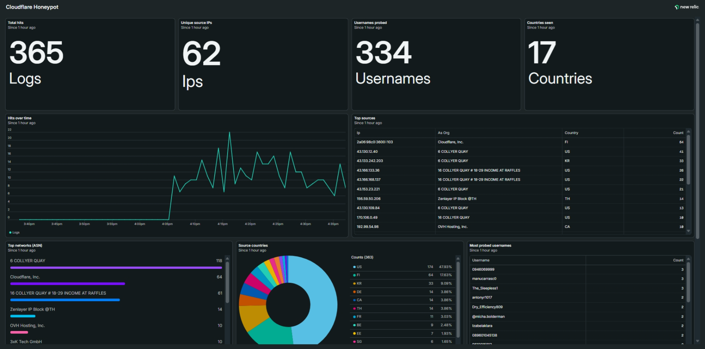

# cloudflare-honeypot

Turn a user-enumeration endpoint into a trap. A small Cloudflare Snippet answers
scanner probes with a believable **fake** user profile, logs who asked, and never
touches your origin server.

Built for Discourse forums (`/u/<username>.json`), works for any framework that
exposes a predictable per-user endpoint.

```
                    scanner walks /u/alice.json, /u/bob.json, ...
                                     |
                                     v
                        +----------------------------+
                        |  Cloudflare Snippet        |
                        |  "does a real client       |
                        |   send this?"              |
                        +-------------+--------------+
                          no |                 | yes (cookie,
                             v                 |  referer, Accept:
                +-------------------------+    |  html, Api-Key)
                | fake 200 + fake profile |    v
                | one log line to New     |  +------------------+
                | Relic / Discord         |  | your origin      |
                +-------------------------+  | (Discourse)      |
                                             +------------------+
```

## What it looks like



One hour on a mid-size Discourse forum: 365 probes from 62 source IPs, 334
distinct usernames, 17 countries. The shape of the traffic is the interesting
part — the top networks are rented proxies and hosting ranges, not one attacker
on one machine, which is why blocking a single IP achieves nothing.

## Why

User-enumeration scans look like this in your logs:

```
/u/queensarahz.json      404
/u/schadomaster.json     404
/u/kortney_renee.json    404
/u/dry_efficiency889.json 404
```

Every one of those is a wasted request that reaches your app server, and every
404 tells the scanner "this name does not exist" — which is exactly the signal it
wanted. The scan is cheap for them and costs you a PHP/Unicorn worker per probe.

This repo flips it: the probe gets a `200` with a profile that never existed, so
the scanner cannot tell a real username from a fake one, keeps going, and leaves
a detailed log line behind. Your origin sees nothing.

## What you get

- **Zero origin load.** Matched requests are answered at the edge. No subrequest,
  no fetch to your server. Your origin gets *less* traffic than before.
- **Zero false positives.** Real clients carry a session cookie, a referer, or an
  `Accept: text/html`. Only scripts reach the fake branch, so every logged hit is
  a confirmed scanner.
- **A canary.** Every fake profile contains a marker string and a fake email
  address, so anything harvested can be traced back to your trap.
- **Structured logs** in New Relic (or Discord/Slack): IP, ASN, network, country,
  city, edge colo, HTTP/TLS version, user agent, accept headers, referer,
  username probed.
- **A ready-made dashboard** with 11 widgets — see `dashboards/`.

## Quick start

**1. Deploy the snippet** (Cloudflare dashboard → Rules → Snippets → Create):

```js
// paste snippet/honeypot.js, then set CANARY and your sink in CONFIG
```

**2. Add the snippet rule** — a snippet does nothing until a rule matches it:

| Field | Operator | Value |
| --- | --- | --- |
| URI Path | wildcard | `/u/*.json` |

```
(http.request.uri.path wildcard "/u/*.json")
```

Use **URI Path**, not URI Full — `full_uri` includes the query string, so
`/u/foo.json?x=1` would slip past.

> **Plan note:** the `matches` operator (regex) requires a Business plan or WAF
> Advanced. `wildcard` is available on Pro. The snippet re-checks the path in
> code, so a broad wildcard is safe.

**3. Send the logs somewhere.** New Relic Log API (one subrequest, free tier is
generous) or a Discord/Slack webhook:

```js
NEW_RELIC_LICENSE_KEY: "<ingest license key>",
NEW_RELIC_ENDPOINT: "https://log-api.newrelic.com/log/v1",
LOG_URL: "",   // optional second sink
```

**4. Import the dashboard.** Read the next section first — two fields must be
changed or the import fails.

**5. Test it like a scanner:**

```bash
curl -s -H 'Accept: */*' https://forum.example.com/u/nosuchuser999.json | head -c 300
```

You should get a fake profile with `"_hp"` in it, and a hit in New Relic a minute
later.

## Importing the dashboard — the two things that trip everyone up

`dashboards/newrelic-honeypot.json` is a dashboard in New Relic's import format.
It ships with placeholders so it is safe to publish. **Both of these must match
your setup, or you get a `Failed to create dashboard` / `Schema` error:**

### 1. `accountId` must be your real New Relic account id

The file contains `"accountId": 0` eleven times. Zero is not an account, and the
import validates it before creating anything — this is the single most common
failure. Find your id, then replace all eleven:

- **Where to find it:** New Relic → account switcher at the bottom-left (the id
  is listed next to the account name), or the URL of any page:
  `one.newrelic.com/accounts/<id>/...`, or Query your data → the account picker.

```bash
# macOS / Linux
sed -i 's/"accountId": 0/"accountId": 1234567/g' dashboards/newrelic-honeypot.json
```

```powershell
# Windows PowerShell
(Get-Content dashboards/newrelic-honeypot.json) -replace '"accountId": 0', '"accountId": 1234567' |
  Set-Content dashboards/newrelic-honeypot.fixed.json
```

Or skip the editing entirely — the script does the substitution for you:

```bash
export NEW_RELIC_ACCOUNT_ID=1234567
export NEW_RELIC_USER_KEY=NRAK-...        # USER key, not a license key
export HONEYPOT_CANARY=<your CONFIG.CANARY>
bash scripts/create-dashboard.sh
```

### 2. The canary in the queries must match your `CONFIG.CANARY`

The widgets filter on `canary = 'honeypot-canary-0001'`, the placeholder value
from `snippet/honeypot.js`. If you changed `CANARY` in the snippet — you should —
change it in the dashboard too, all eleven occurrences. Otherwise the dashboard
imports cleanly and then shows zeros forever, which looks like a broken pipeline.

The `HONEYPOT_CANARY` environment variable above does this in the script path.

### 3. Then, after it imports

- Set the dashboard time range to **7 days**. The default range is often 30
  minutes, which makes a working dashboard look empty.
- Permissions: "Edit – everyone in account" if your team should be able to
  tweak it.

Full walkthrough, including how to bisect an import that still fails:
[`docs/newrelic.md`](docs/newrelic.md#5-dashboard).

## How the decision is made

No origin round trip, no state, no KV. The snippet reads the request's own
headers:

| Real client sends | Result |
| --- | --- |
| session cookie (`_forum_session`, `_t`, `xf_session`, …) | pass to origin |
| `Referer` from your own host | pass to origin |
| `Api-Key` / `Api-Username` (Discourse API clients) | pass to origin |
| `Accept: text/html` (browser navigation) | pass to origin |
| none of the above | **fake profile** |

That last row is what a scanner looks like. It is also why a plain `curl` is the
right way to test.

## Configuration

| Key | Default | Meaning |
| --- | --- | --- |
| `CANARY` | `honeypot-canary-0001` | Marker inside every fake response. Change it. |
| `SESSION_COOKIES` | Discourse names | Cookies that mean "real visitor". |
| `NEW_RELIC_LICENSE_KEY` | `""` | Ingest license key. Empty disables. |
| `NEW_RELIC_ENDPOINT` | US | US / EU / JP Log API endpoint. |
| `LOG_URL` | `""` | Optional Discord/Slack webhook. |
| `PROBE_ORIGIN` | `false` | **Leave off.** Sends one request per probe to your origin. |

Subrequest budget: each configured sink costs one. Pro allows 2, Business 3, Free
0. With both sinks set you are at exactly 2.

## What this does not do

- **It does not block anyone.** Snippets have no persistent state, so they cannot
  remember an IP. Blocking is a WAF rule — see `docs/deploy-cloudflare.md`.
- **It does not stop the scan**, only its value and its cost to you.
- **It is not a substitute for a WAF.** It is a detection and attribution layer.

## Alternatives worth knowing

- **Discourse:** `hide user profiles from public` makes `/u/<user>.json` return
  403 to anyone logged out, killing anonymous enumeration at the source. Cheaper
  than this repo if public profiles do not matter to you. Run both if they do.
- **WAF:** a `managed_challenge` on the same path (excluding `cf.client.bot`) also
  runs at the edge, but tells the bot it was caught.

## Limits

Cloudflare Snippets: 5 ms CPU, 2 MB memory, 32 KB package, no KV, no bindings, no
environment variables. This snippet uses a fraction of that and one subrequest.

New Relic free tier: 100 GB/month ingest, 1 full user, unlimited basic users, and
ingest stops (rather than billing) at the cap. A hit is ~400 bytes.

## Repo layout

```
snippet/honeypot.js              the code
dashboards/newrelic-honeypot.json 11-widget dashboard (placeholder accountId)
scripts/create-dashboard.sh      NerdGraph import, fills in accountId + canary
docs/deploy-cloudflare.md        Cloudflare steps, API, rollback, WAF option
docs/newrelic.md                 license key, queries, dashboard import, alerts
docs/discourse.md                Discourse specifics and caveats
docs/troubleshooting.md          "nothing is logging" and "import failed" checklists
docs/images/dashboard.png        screenshot used above
examples/sample-log.json         one log entry, exactly as sent
```

## Honest status

The snippet logic is unit-tested against mock requests (filter matrix, payload
shape, sink failure, zero-subrequest path). The dashboard JSON is validated for
New Relic's 12-column layout and widget schema, and it has been imported into a
live account; the NerdGraph script has not been run end to end everywhere.

## License

MIT. See `LICENSE`.
